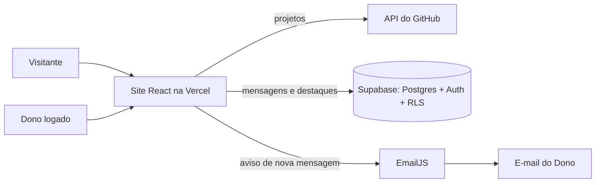
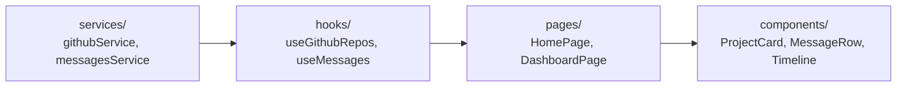
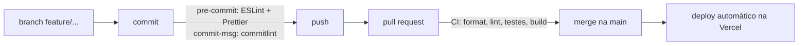

# Roteiro do vídeo (entrevista técnica)

Cenário: entrevista para uma vaga de front-end, apresentando o portfólio com foco na stack e no harness de IA.

**Regras da entrega:** no máximo 8 minutos, rosto e tela visíveis o tempo todo, YouTube **não listado**.

| Parte | Tempo | Duração |
| --- | --- | --- |
| Abertura | 0:00–0:30 | 30 s |
| 1. Stack e arquitetura | 0:30–3:30 | 3 min |
| 2. Justificativas da stack | 3:30–5:45 | 2 min 15 s |
| 3. Harness de IA | 5:45–7:30 | 1 min 45 s |
| Fechamento | 7:30–7:50 | 20 s |

Antes de gravar, deixe abertos:
- o site publicado (home, `/projetos`, `/contato` e `/dashboard` logado);
- o VS Code com o repositório;
- este arquivo no GitHub (os diagramas aparecem desenhados);
- a aba de um PR já mergeado, com o check do CI.

---

## Abertura (30 s)

> "Oi, eu sou o Enzo, Analista de Produtos no PicPay e estudante de Engenharia de Software na FIAP. Vou mostrar o meu portfólio em React: primeiro a stack e a arquitetura, depois por que escolhi cada peça e, no fim, como configurei a IA que me ajudou a construir."

**Tela:** home do site publicado, rolando devagar até os Destaques.

## Parte 1: Stack e arquitetura (3 min)

**Tecnologias e como se conectam (1 min).** Mostre o diagrama abaixo.

> "O site é React 19 com Vite. Os projetos vêm direto da API do GitHub, sem cadastro manual. Mensagens, login e destaques ficam no Supabase, e o EmailJS me avisa por e-mail quando chega mensagem."

**Estrutura de pastas e fluxo de dados (1 min).** Mostre no VS Code e o diagrama:

> "Quem fala com a API é só o `services`. O hook guarda os estados de carregando, erro e dados. A página decide o que mostrar, e os componentes só recebem props. Por isso nenhum componente tem `fetch`."

**Critério para dividir componentes (30 s).**

> "Um componente por responsabilidade visual, reaproveitado no site inteiro. O mesmo `Card` está nos projetos, na linha do tempo e nos cards de skill. O mesmo `Button` faz link interno, link externo e botão com spinner."

Mostre `components/Card/Card.jsx` e onde ele é usado.

**Da branch ao deploy (30 s).**

**Tela:** um PR mergeado com o check verde. Tente um commit com mensagem errada no terminal para mostrar o commitlint recusando.

## Parte 2: Justificativas da stack (2 min 15 s)

Use o [`docs/decisoes.md`](decisoes.md). Para cada uma: opções comparadas, critério e o que aceitei perder. Sugestão de 5 decisões, cerca de 25 s cada:

1. **Supabase** (contra Firebase e backend próprio): login e dados num serviço só, com proteção real no banco (RLS). Perdi: dependo de um serviço externo e do plano gratuito.
2. **Como o banco reconhece o Dono:** uma tabela `owner` em vez de "qualquer usuário logado". Se alguém criar uma conta, continua sem ver as mensagens. Perdi: um passo manual na configuração. *Mostre `supabase/schema.sql`.*
3. **Cache do GitHub:** memória + `sessionStorage` por 10 minutos, em vez de token. Sem token, nada secreto vai para o navegador. Perdi: dados até 10 minutos desatualizados.
4. **Tema sem flash:** script inline no `index.html` aplica o tema antes do React carregar; só grava quando o visitante escolhe. Perdi: a primeira visita nem sempre abre no tema escuro.
5. **Testes com Vitest + Testing Library** (contra Playwright): rodam no mesmo Vite e cobrem a validação do formulário e o bloqueio do dashboard. Perdi: não há teste de ponta a ponta no navegador real. *Rode `npm test` na tela.*

## Parte 3: Harness de IA (1 min 45 s)

Use o [`docs/harness-ia.md`](harness-ia.md).

**Ferramenta e modelo (20 s).**

> "Usei o Claude Code no VS Code, com o modelo Claude Opus 5.5, porque ele trabalha direto no repositório e carrega sozinho as regras que eu versionei."

**Arquivos versionados (50 s).** Abra cada um rapidamente:
- `CLAUDE.md`: regras que valem em toda conversa (pastas, convenções, Git, comandos antes de entregar);
- as três skills em `.claude/skills/`: o que entregar, como escrever React e o design system;
- `.claude/agents/revisor.md`: o agente que revisa a branch antes do PR;
- `.claude/settings.json` e `.mcp.json`: permissões (bloqueia `.env`, `--force` e `--no-verify`) e conectores, sem segredo.

**Como isso garante os padrões (35 s).**

> "As regras dizem o que fazer, e as ferramentas conferem. Arquitetura e código: as skills orientam, e ESLint, Prettier e o revisor verificam. Commits: o commitlint recusa mensagem fora do padrão. Branches: nunca commito na main, e tudo entra por PR com CI. E quando a IA saía do combinado, eu corrigia e virava regra: por exemplo, uma revisão achou recursos fora da apostila, e eu troquei pelos da disciplina e registrei a decisão."

## Fechamento (20 s)

> "Os links do repositório e do site estão na descrição. Obrigado!"

**Tela:** volta para a home do site.

---

Checklist de gravação:
- [ ] 8 minutos ou menos
- [ ] Rosto visível o tempo todo (câmera no canto)
- [ ] Tela legível (zoom de 125% no VS Code e no navegador)
- [ ] Upload como não listado
- [ ] Links no Teams: GitHub, Vercel e YouTube
